

  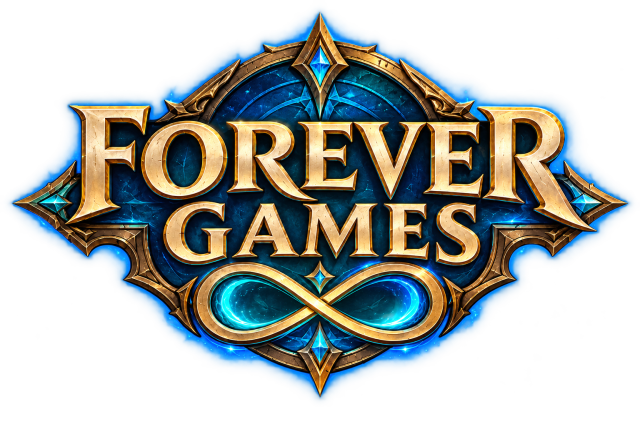

  
  
  
  
  
  

  <b>Chess, cards, dice, puzzles and more, inside World of Warcraft.</b> 
  Play your guildies and friends one move at a time, or play on your own.

---

Forever Games is an addon for playing games with your guildies and friends. You challenge
someone, make your move, and go back to whatever you were doing. They answer whenever they're next
online, even if that's tomorrow. When it's your turn again, the addon lets you know.

Nobody around? Nearly every game for two or more can be played against the computer, and there are
puzzles and solo games with a new challenge for your guild every day.

- [Install](#install)
- [The games](#the-games)
- [Getting started](#getting-started)
- [Playing with other people](#playing-with-other-people)
- [How to play each game](#how-to-play-each-game)
- [Commands and options](#commands-and-options)
- [Good to know](#good-to-know)

## Install

1. Download `ForeverGames-<version>.zip` from the
   [latest release](https://github.com/jeany55/forever-games/releases/latest).
2. Unzip it into `Interface\AddOns`, inside the folder for the version of the game you play in your
   World of Warcraft folder. Create the `AddOns` folder if it isn't there.
3. You should now have three folders there: `ForeverGames`, `ForeverGames_Freedoom` and
   `ForeverGames_Places`. Keep all three. The last two hold the maps for Freedoom and the pictures
   for Where in Azeroth, which is why the download is large. They are only loaded when you play
   those games.
4. Restart the game if it was running, and check Forever Games is ticked in the AddOns list on the
   character screen.

To update, unzip the new version over the old one. Your games in progress and your best times are
kept.

Everyone you play needs the addon too. Try to stay on the same version as your friends: if yours
differ, the challenge tells you.

## The games

### With friends, or against the computer

| | Game | Players | |
|---|---|---|---|
| 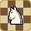 | Chess | 2 | Take as long as you like between moves. |
| 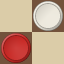 | Checkers | 2 | Jump to capture, reach the far side to be crowned. |
|  | Reversi | 2 | Trap discs between yours to flip them. |
|  | Connect Four | 2 | Four in a row: across, up or diagonal. |
|  | Tic Tac Toe | 2 | Over in a minute. |
| 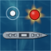 | Battleship | 2 | Hide your fleet, then hunt for theirs. |
|  | Backgammon | 2 | Race your checkers home by the roll of the dice. |
|  | Chinese Checkers | 2, 3, 4 or 6 | Hop your marbles across the star. |
| 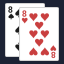 | Crazy Eights | 2 to 6 | Match the suit or the rank. Eights are wild. |
|  | Words with Warcraft | 2 to 4 | A Scrabble-style word game where Azeroth's names count, and score extra. |
| 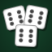 | Yacht-Z | 1 to 4 | Five dice, three rolls, thirteen boxes to fill. |
| 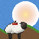 | Wormcraft | 2 to 4 | Artillery the way Worms played it, with fireballs, grenades and sheep. |

### On your own

| | Game | Daily challenge | Race a friend | |
|---|---|:---:|:---:|---|
| 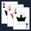 | Solitaire | Yes | | Klondike. |
| 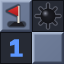 | Minesweeper | Yes | Yes | Three field sizes, best time kept for each. |
| 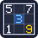 | Sudoku | Yes | Yes | A fresh puzzle every time, Easy to Expert. |
|  | 2048 | Yes | | Slide and merge tiles. Boards of 3, 4 or 5. |
|  | Tetris | Yes | Yes | Marathon, 40-line Sprint, or two minutes for points. |
| 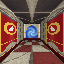 | Warcraftstein 3D | Yes | Yes | Fight through the Scarlet Monastery in first person, as your own class. |
| 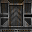 | Freedoom | | Yes | The free version of Doom, drawn inside WoW. Race the ghost of your best run. |
| 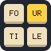 | Fourtiles | Yes | | A word puzzle. A friend can join in and solve it with you, no turns. |
|  | Yacht-Z | | | Fill the card alone. 200 points is a win. |
| | Where in Azeroth | Yes | Yes | You're dropped somewhere in the world. Look around and pin where you think you are. |

### Party games

Party games are played in a room that your guild, your group, or people you invite can join.
Anyone can come and go while it's open.

| Game | |
|---|---|
| Sketch | One person draws, everyone else guesses. The sooner you guess, the more it's worth. |
| Trivia | A quiz in the style of Kahoot, good for a raid waiting on someone. General knowledge, Warcraft lore from the Third War to the Lich King, or both. |

## Getting started

1. Type `/fg` or click the minimap button to open the window.
2. Press **New Game** and pick a game. You can search, filter by type or number of players, and
   star your favourites so they stay at the top.
3. Pick who to play. The last person you played is at the top, then guildies and friends who are
   online with the addon. You can also type any name. Next to the list are the game's rule
   options, like whether captures are forced in Checkers.
4. Send the challenge. The game starts once they accept.

For a game against the computer, press **+ Computer** on an empty seat. For a game you play alone,
it starts as soon as you pick it.

The top of the window shows how many of your guildies and friends are online with the addon.

## Playing with other people

### Taking turns

You don't need to be online at the same time. Moves are delivered when you're both online. If the
others moved while you were away, the game plays their moves out in order before you take your
turn. Press **Skip** or Space to jump to the current position.

### Bigger tables

Games for three or more show a row of seats. Click players in the list, or type a name and press
Enter, to fill them. **Seats** changes how many there are. The game starts when everyone has
accepted, and is called off if anyone declines. If someone resigns, the rest play on.

### The computer

Each computer seat has its own level. Easy makes mistakes, Medium thinks a few moves ahead and
rarely slips, and Hard looks as far ahead as it can. Against the computer you can use
**Take Back** (except where it would reveal something, like cards or dice), **Offer Draw**, and
**Play Again** to swap sides and go again. It only thinks while the game is on screen. Hover over a
computer seat's level to see your record against it.

### Mixing people and the computer

In a game for three or more, you can fill some seats with people and the rest with the computer.
Your client plays the computer's moves (never during combat), so the others wait on you being
online. If you resign, the next person in the game takes over the computer.

### Link in Chat

For a two-player game, **Link in Chat** puts a link like `[Forever Games: Chess]` in your chat box.
Post it in party, guild or anywhere else, and the first person with the addon to click it plays
you. The link lasts an hour.

### Today's Challenge

Games with a pocket watch on their card have a daily challenge. Everyone in your guild gets the
same deal that day: the same Solitaire shuffle, the same minefield, the same Sudoku. You get one
try, with no undo. The **Guild Board** shows how everyone did. A new challenge starts at midnight
UTC.

### Races

The solo games marked in the table above can be raced. Pick a friend in the second step and choose
**Challenge to a Race**. You both get exactly the same game and play it whenever you like. The
better result wins: the quicker time, or the higher score in Where in Azeroth and in Tetris's
Marathon and Ultra. Any finish beats not finishing (hitting a mine, dying, or using a Sudoku hint).
While you play, you can see the result to beat. In Freedoom you also see your rival's ghost
running the map, and **Send My Best** lets you challenge someone with a run you've already made.

### Party rooms

Pick Sketch or Trivia from the list and choose who the room is for: your guild, your group, or
only the people you invite. Rooms other people have open are listed there too. The host can invite
anyone by name or post a link in chat, including a few people from outside the guild or group.
**Make Small** shrinks the game into a corner of your screen, and it comes back when it's your
turn. The room closes when the host leaves.

## How to play each game

Click a game to see its controls. Keyboard controls only work while the mouse is over the game,
unless the game says otherwise.

<b>Chess</b>

- Drag a piece, or click it and then click where it goes.
- To look back through the game, click a move in the list, use the buttons under it, or scroll
  the mouse wheel over the board.
- **Offer Draw** is sent with your next move. Your opponent declines by playing on.

<b>Checkers</b>

- Moves work like chess: drag, or click then click.
- When you can capture, the pieces that have to are pointed out (captures are forced unless the
  game was set up otherwise).
- For a multi-jump, click each square in turn. Right-click to take it back and choose again.

<b>Connect Four, Reversi and Tic Tac Toe</b>

- Connect Four: click anywhere in a column to drop a disc.
- Reversi: click one of the marked squares.
- Tic Tac Toe: click a square.

<b>Chinese Checkers</b>

- Click a marble, then one of the marked holes. Every hole it can reach is marked, however many
  hops it takes.
- Your corner is always at the bottom. The list beside the board shows who is which colour and
  whose turn it is.

<b>Backgammon</b>

- The dice are rolled for you.
- Click a checker and then where it goes, or drag it. The points it can reach are marked.
- Build your turn one checker at a time. **Undo** or right-click takes the last one back.
- Nothing is sent until you press **Play**. A roll you can't use at all is skipped for you.

<b>Crazy Eights</b>

- Cards you can play stick up out of your hand. Click one to play it.
- Playing an eight asks which suit comes next.
- Click the deck to draw instead. If the card you drew can be played, you can play it or
  **Pass**.
- Everyone's cards are shown when the game ends.

<b>Battleship</b>

- Your fleet starts in a random layout. Click a ship to pick it up and click the water to put it
  down. Right-click or **Rotate** turns it, **Random** shuffles the whole fleet.
- Press **Deploy** when you're happy. You can do this while you wait for the other player.
- Then click a square on their sea to fire. You see the result straight away, even if they're
  offline.
- The sea you aren't playing on is shown small. Click it for a closer look.

<b>Words with Warcraft</b>

- Drag tiles from your rack onto the board, or click a square and type.
- The **Play** button shows what the word would score. The mouse wheel zooms.
- **Shuffle** rearranges your rack, **Recall** takes your tiles back, **Swap** trades tiles with
  the bag, and **Pass** skips your turn.
- You can lay tiles out while it's someone else's turn to see what they would make.
- Words from Warcraft (names, places, slang) count and score a bonus, and the big names like Thrall
  score more. Whoever sets up the game can change the bonuses, turn Warcraft words off, and choose
  how many blanks are in the bag.

<b>Yacht-Z</b>

- Each turn, roll five dice up to three times. Click dice to keep them between rolls.
- Then pick a box on your card. Every box gets used once, and a roll that doesn't fit a box scores
  zero there.
- Ones to sixes get a 35 point bonus if they add up to 63 or more.
- Alone, 200 points is a win. At a table, the highest score wins.

<b>Wormcraft</b>

- Up to four squads on an island, people or computer. Easy throws roughly your way, Hard rarely
  misses.
- Everyone picks a class first. Each has a skill of its own, like a warrior's Charge or a mage's
  Blink.
- On your turn: walk with the arrow keys or A and D, aim with up and down or W and S, and hold
  Space to charge a shot. Enter jumps, Backspace flips backwards, Tab switches squad member (before
  you move).
- Pick a weapon under the island, or with Q and E. Fireballs drift with the wind, grenades bounce
  until their fuse runs out, and blizzards and kodos land where you click.
- After firing you have three seconds to run.
- Everyone levels up each round and unlocks more weapons. Crates drop from a zeppelin between
  turns, and the sea starts rising from a round chosen at setup.
- The mouse wheel zooms, and dragging moves the view. When you open the game, turns you missed are
  replayed. Space skips them.

<b>Fourtiles</b>

- Twenty tiles, cut from five four-tile words. Click one to four tiles to spell a word, then press
  **Enter**.
- Words score 1, 2, 4 or 8 points depending on how many tiles they use. Finding all five original
  words is worth 40 more.
- **Shuffle** (or Space) rearranges the tiles. Backspace removes the last tile.
- Once you've found all five and reached Master (100 points), **Call It Done** ends the game.
- With a friend there are no turns: you both play whenever you like and your finds are combined.

<b>Solitaire</b>

- Drag a card, with any cards on top of it, to where it should go. Or click it: it goes to the
  foundation if it can, otherwise to the first column that will take it.
- Right-click only ever sends a card to the foundation.
- Click the stock to turn a card, and click it again when empty to go through once more.
- When every card is face up, **Finish** plays out the rest for you.

<b>Minesweeper</b>

- Choose a size: 10, 40 or 99 mines.
- Left-click to open a square. Your first click is always safe.
- Right-click to place or remove a flag.
- Left or middle-click a number that has all its flags to open the squares around it.
- Hover a number to see which squares it still refers to.
- The clock starts on your first click. Your best time at each size is kept.

<b>Sudoku</b>

- Choose a difficulty from Easy to Expert, and whether mistakes are pointed out as you go.
- Click a square or move with the arrow keys, then type a digit or click the keypad. Each key
  shows how many of that digit are still missing.
- Type the same digit again, or Backspace, to clear it.
- **Notes** (or N, or Space) switches to pencil marks. They tidy themselves up as you fill digits
  in.
- **Hint** fills in the square you're on, but a game with a hint doesn't count for your best time.
- Keys don't work in combat.

<b>2048</b>

- Slide tiles with the arrow keys or WASD, by dragging across the board, or with the arrow buttons
  beside it.
- Two tiles with the same number merge.
- Reaching 2048 wins, but you can keep going until nothing can move. On a 3x3 board the target is
  256.
- Your best score and biggest tile are kept for each board size.

<b>Tetris</b>

- Three modes: **Marathon** (150 lines, speeding up every 10, start at any level), **Sprint**
  (40 lines against the clock), and **Ultra** (as many points as you can in two minutes).
- Left/Right or A/D to move (hold to slide to the wall). Up, X or W rotates, Z or Q rotates back.
  Down or S soft drops, Space hard drops, C or Shift holds.
- While a game is running, the keys belong to Tetris wherever your mouse is. They go back to your
  character when it's paused or over.
- P or Escape pauses. Closing the window or entering combat pauses too, and it counts you back in.
- It plays like modern Tetris: 7-bag, five next pieces, ghost piece, wall kicks, and a short delay
  before a piece locks. Tetrises, T-spins, back-to-backs, combos and clearing the whole board score
  the most.
- In a race, Sprint is won on time and the others on points. You see how far your rival had got at
  the same moment.

<b>Warcraftstein 3D</b>

- Fight through the Scarlet Monastery's graveyard, library and cathedral to the armory, where
  Herod guards the portal out. It stays shut until he dies.
- You start in a chapel the Crusade won't enter. You heal there but can't attack. Go back whenever
  you need to.
- Play as your character's class (press Space) or pick another. Each class fights differently and
  has an extra ability, like a rogue's stealth or a shaman's totem.
- Kills give experience, levels give talent points. Press N for talents.
- W/S or up/down to walk, A/D or left/right to turn, Q/E to strafe, Space to attack, F for your
  class ability. Or hold the right mouse button to turn with the mouse, with A/D to strafe.
- Walk over potions to drink them: red for health, blue for mana, rage or energy.
- The monastery freezes when your mouse leaves the game or talents are open.
- Choose how many rooms at setup. Your best time for each size is kept. Your position and talents
  aren't: if you log out, you start again.

<b>Freedoom</b>

- The first episode of [Freedoom](https://freedoom.github.io), the free Doom, plus Run: one long
  map made for the addon, with no wrong turns.
- Choose a map and one of Doom's four skill levels. On the easiest you take half damage and get
  double ammo.
- Get to the exit as fast as you can. Your best time for every map and skill is kept, and Doom's
  end-of-level screen shows your kills, items and secrets.
- Replay a map and the ghost of your best run races beside you. Race a friend and you see theirs,
  with their name over its head.
- Ctrl, F or left-click fires. 1 to 7 switches weapons. Space opens doors and presses switches,
  Shift runs. Movement uses the same keys as Warcraftstein.
- F5 switches to low detail if it's running slowly. Tab shows how long each frame takes to draw.

<b>Where in Azeroth</b>

- You're shown a spot somewhere in the world. Drag to look around.
- Pin where you think you are on the map. The closer you are, the more points, up to 5,000.
  The wrong continent scores nothing.
- Five places per game. Whoever sets it up can add a time limit for each place.
- Races are won on points, and you see your rival's guesses on the map next to yours.

<b>Sketch</b>

- The person drawing picks one of three things and draws it. Everyone else types guesses.
- Quicker guesses score more, and the artist scores for everyone who gets it.

<b>Trivia</b>

- Everyone gets the same question at once, with two to four answers marked by raid icons. Click
  one, or press 1 to 4 with your mouse over the game.
- A right answer is worth up to 1,000 points, less the longer you take, with a bonus for streaks.
- When time is up, or everyone has answered, the right answer lights up along with how many people
  picked each one.
- The host chooses the topic, number of questions and time per question. The host won't repeat
  questions it asked recently.
- If the host enters combat, the quiz pauses and that question doesn't count. It carries on a few
  seconds after the fight. The host can also **Pause** and **Go On** by hand.

<b>Any game you play alone</b>

- **Undo** takes back moves, as many as you like (not in a daily challenge or race).
- **Start Another** swaps the game for a new one. **Give Up** removes it from your list.
- Games wait for you as long as you like.

## Commands and options

| Command | What it does |
|---|---|
| `/fg` | Open or close the window (same as the minimap button) |
| `/fg new` | Start a new game |
| `/fg play <game>` | Play a game alone, or against the computer, set up the way you last had it |
| `/fg daily <game>` | Go straight to today's challenge |
| `/fg challenge <player> [game]` | Challenge someone. Leave the name out to challenge your target |
| `/fg party` | Open the party rooms |
| `/fg options` | Open the options (or right-click the minimap button) |
| `/fg log` | Show recent addon messages, for tracking down problems |

`/forevergames` works the same as `/fg`.

The window can be resized from its corner, and the board grows with it. **Focus** hides everything
except the game you're looking at.

In the options (also under AddOns in the game's settings) you can choose:

- whether your turn is announced with a message, a sound, or both
- whether that happens in combat, or waits until you leave an instance
- whether the games make their own sounds
- whether anyone can challenge you, or only friends and guildies
- whether the minimap button is shown, and how big the window is

## Good to know

### There's no server

Moves are sent straight between players as addon whispers. A move reaches the other player the
next time you're both online at once, and outside any instance that blocks addon messages. Until
then it's kept and sent later. In games for three or more, whoever is online passes on what
someone missed.

### It's fair the way a game at a table is fair

With no server, there's nobody neutral to shuffle the deck or roll the dice. Every player's addon
works them out the same way from the moves made so far, and only shows you what you're meant to
see. That keeps a friendly game honest, but it won't stop someone determined to peek at cards that
aren't theirs.

### Something not working?

`/fg log` shows what the addon sent and received recently. The full log is saved in
`WTF\Account\<account>\SavedVariables\ForeverGames.lua` when you log out or `/reload`. Please
[open an issue](https://github.com/jeany55/forever-games/issues) saying what happened, with the
log if you can.

## Contributing

Want to fix something or add a game? [CONTRIBUTING.md](CONTRIBUTING.md) covers running the tests,
how the code is laid out, and how a game is put together.

## Credits

Freedoom's maps, textures, sprites, status bar and messages are from
[Freedoom](https://freedoom.github.io) 0.13.0 by the Freedoom contributors, used under its BSD
licence. See `ForeverGames_Freedoom/COPYING.txt` and `ForeverGames_Freedoom/CREDITS.txt`.

The chess pieces are from
[ChessCraft Creative Commons](https://gitlab.com/zulban/chesscraft-creative-commons) by Zulban,
used under CC BY-SA 4.0. See `Images/Chess/README.md`.

The playing cards, dice and sounds are from the Boardgame Pack by [Kenney](https://www.kenney.nl),
released into the public domain (CC0).

The Fourtiles word list was picked with the help of [SCOWL](http://wordlist.aspell.net) by Kevin
Atkinson.

The letters on the Fourtiles and Words with Warcraft tiles are drawn in
[Lexend](https://github.com/googlefonts/lexend) by The Lexend Project Authors, used under the SIL
Open Font License 1.1. See `Images/Lettering/Lexend-OFL.txt`.

## Licence

[MIT](LICENSE). Freedoom's assets, the chess pieces and Lexend keep their own licences, listed
above.
